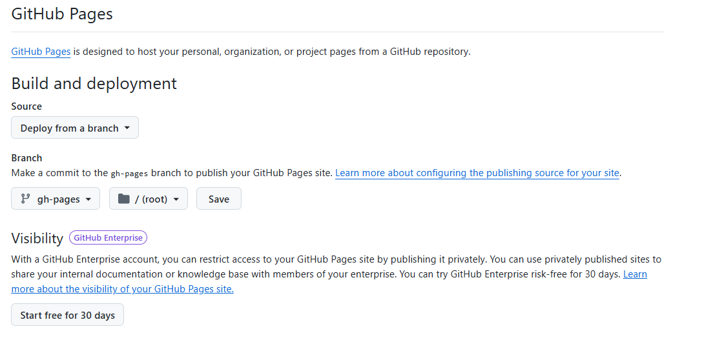
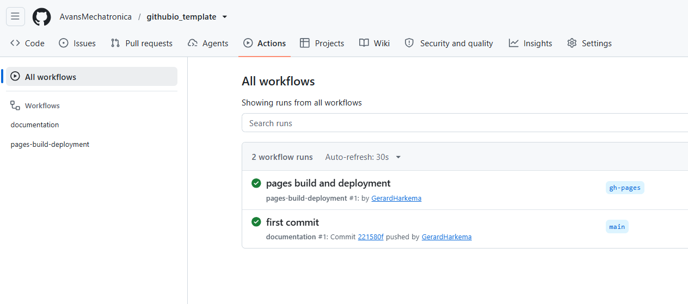

# Documentatie bijwerken en publiceren

Deze documentatie wordt gemaakt met [Sphinx](https://www.sphinx-doc.org/) en
[MyST](https://myst-parser.readthedocs.io/), zodat de pagina's in Markdown
geschreven kunnen worden. Bij elke `git push` naar `main` bouwt een GitHub Action
de site en zet die op GitHub Pages.

## Structuur

```text
documentation/
├── conf.py              Sphinx-configuratie (projectnaam, thema, extensies)
├── index.rst            startpagina en inhoudsopgave
├── requirements.txt     Python-pakketten voor het bouwen
├── documentation/       de pagina's (Markdown)
├── images/              afbeeldingen
└── _static/             logo en statische bestanden
.github/workflows/documentation.yml   GitHub Action die bouwt en publiceert
```

Een nieuwe pagina voeg je toe door een `.md`-bestand in `documentation/documentation/`
te zetten en het op te nemen in de `toctree` van `index.rst`.

## Lokaal bouwen

Vanuit de hoofdmap van de repository:

::::{tab-set}

:::{tab-item} Windows (PowerShell)
```powershell
python -m venv .venv
.venv\Scripts\Activate.ps1
pip install -r documentation/requirements.txt
sphinx-build documentation _build
start _build\index.html
```
:::

:::{tab-item} Linux / macOS
```bash
python3 -m venv .venv
source .venv/bin/activate
pip install -r documentation/requirements.txt
sphinx-build documentation _build
open _build/index.html
```
:::

::::

## Publiceren op GitHub Pages

1. Commit en push je wijzigingen naar `main`:

```bash
git add .
git commit -m "Documentatie bijgewerkt"
git push
```

2. De workflow **documentation** bouwt de site en zet het resultaat op de branch `gh-pages`.
3. Stel eenmalig in de repository-instellingen onder **Pages** de bron in op de
   branch `gh-pages` (map `/ (root)`) en klik op **Save**.



Daarna staat de documentatie op `https://<gebruiker>.github.io/<repository>/`.

## Valkuilen

- Controleer in het tabblad **Actions** of de workflow slaagt. Een fout in een
  pagina (bijvoorbeeld een ontbrekend bestand in de `toctree`) laat de build mislukken.
- De workflow heeft schrijfrechten nodig (`permissions: contents: write`) om de
  branch `gh-pages` bij te werken.
- Publiceren gebeurt alleen bij een push naar `main`; bij een pull request wordt
  alleen gebouwd.


